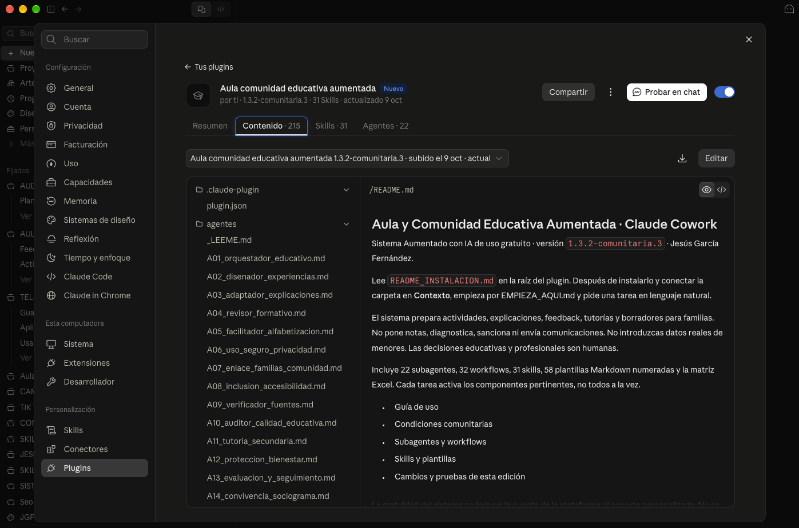
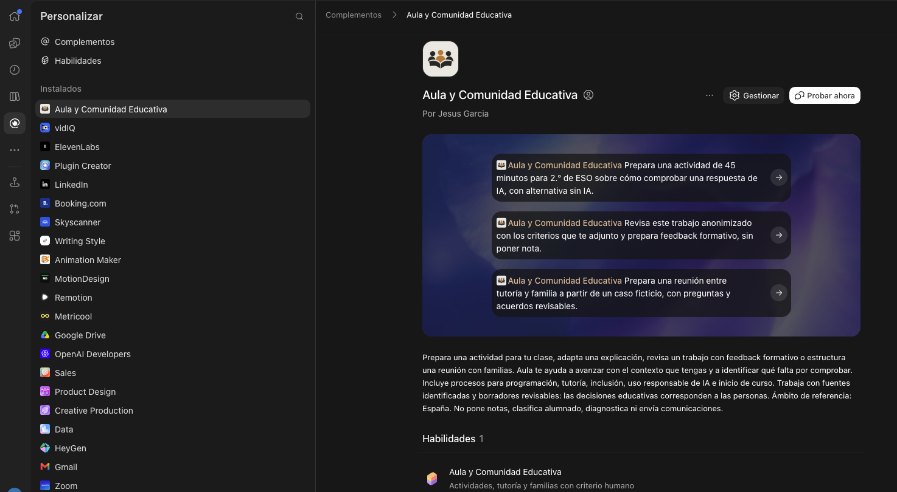

# Aula y Comunidad Educativa Aumentada · Edición Comunitaria

> **English summary:** Aula is a community-edition toolkit that helps secondary-school teachers and educational communities use AI to prepare learning activities, adapt explanations, and organize tutorials. It brings together task-specific instructions, agents, workflows, skills, and templates. Teachers review and adapt every draft and retain responsibility for educational decisions; examples and references focus on Spain and may need adaptation elsewhere.

**Un entorno de apoyo para tu día a día docente, con inteligencia artificial.**

Creado por **Jesús García Fernández (JGF)**. Versión `1.3.2-comunitaria.3`.

[🎬 Ver el vídeo de presentación de Aula en YouTube](https://youtu.be/dOi5jCPj6rY?si=RkyuFjJ7UssIp0Sd)

Aula te ayuda a preparar actividades, adaptar explicaciones, organizar tutorías y elaborar
comentarios que ayuden a tu alumnado a aprender.

Tú aportas tus conocimientos, tus habilidades, tu experiencia docente y el contexto de tu grupo.
Aula te ayuda a desarrollar propuestas que puedes revisar, modificar y adaptar. **La decisión sobre
qué necesita tu alumnado sigue estando en tus manos.**

**Descubre Aula y prueba tu primera tarea.** Elige tu herramienta, descarga el paquete y trabaja con
un ejemplo ficticio antes de incorporarlo a tu práctica.

⭐ Si Aula te resulta útil para preparar tus clases, adaptar materiales u organizar tutorías, deja una estrella al repositorio. Tu apoyo ayuda a que llegue a más docentes y comunidades educativas.

[Elegir descarga](#descargas) · [Leer el manual](documentacion/MANUAL_AULA_DESDE_CERO_v2.pdf) ·
[Ver un caso ficticio](demo/caso_demo_actividad.md) · [Pedir ayuda](.github/SUPPORT.md) ·
[Para medios y entidades](.github/PRESS.md)

## Qué es Aula y para quién está pensado

Aula reúne instrucciones, agentes especializados, workflows, skills y plantillas para orientar
el trabajo con IA en tareas educativas concretas. Un workflow es una secuencia de trabajo; una
skill recoge instrucciones para una capacidad específica. Puedes empezar sin conocer esa arquitectura.

Está pensado principalmente para docentes de Secundaria y comunidades educativas en España.
Las tutorías, familias y equipos del centro tienen recorridos propios. Cada persona configura
su contexto, revisa los borradores y decide qué resulta adecuado para su centro.

## Empieza por una tarea de tu día a día

1. Elige y descarga el paquete para tu herramienta en la tabla siguiente.
2. Extrae el ZIP y sigue su `README_INSTALACION.md`. No necesitas saber usar Git.
3. Explica a Aula qué necesitas. Por ejemplo:

> Soy docente de 3.º de ESO. Ayúdame a preparar una actividad de 45 minutos para que el alumnado
> aprenda a comprobar las respuestas de una IA. Incluye una alternativa sin IA y una forma de
> revisar qué han aprendido.

Aula te ofrecerá una propuesta de partida. Léela con calma, comprueba si encaja con tu grupo y
decide qué quieres utilizar, cambiar o descartar.

El ejemplo es ficticio y no constituye una promesa de resultados.

Para realizar un primer recorrido acompañado, abre [EMPIEZA_AQUI.md](EMPIEZA_AQUI.md).

### Un caso que puedes comprobar

El [caso ficticio de actividad](demo/caso_demo_actividad.md) contiene una petición y los criterios
de la respuesta esperada. Al probar tu propia petición, revisa:

| Paso | Qué comprobar |
|---|---|
| Dar contexto | ¿Curso, objetivo, duración y recursos corresponden a la tarea? |
| Examinar la propuesta | ¿Las instrucciones y los criterios son comprensibles y realizables? |
| Adaptarla | ¿Hace falta cambiar el lenguaje, los apoyos o la alternativa sin IA? |
| Decidir | ¿Qué utilizas, qué corriges y qué descartas antes de llevarlo al aula? |

Los 45 minutos describen la actividad solicitada, no un ahorro de tiempo medido.

## Descargas

### Elige tu complemento

<table>
<tr>
<td align="center" width="50%">
<h3>Claude Cowork</h3>

<a href="paquetes/aula-comunidad-educativa-aumentada-1.3.2-comunitaria.3.plugin">Descargar el plugin para Claude Cowork</a>

</td>
<td align="center" width="50%">
<h3>Codex</h3>

<a href="paquetes/aula-comunidad-educativa-aumentada-1.3.5.zip">Descargar el complemento para Codex</a>

</td>
</tr>
</table>

El complemento para Codex corresponde a la versión `1.3.5`. Las demás descargas de la edición comunitaria conservan la versión `1.3.2-comunitaria.3`.

### Otras opciones

| Si utilizas | Paquete completo |
|---|---|
| ChatGPT Work | [Descargar ZIP](paquetes/aula-comunidad-educativa-aumentada-chatgpt-work-1.3.2-comunitaria.3.zip) |
| Claude Cowork | [Descargar ZIP](paquetes/aula-comunidad-educativa-aumentada-claude-cowork-1.3.2-comunitaria.3.zip) |
| Cualquier otro entorno compatible con Markdown y archivos | [Paquete genérico](paquetes/aula-comunidad-educativa-aumentada-generico-1.3.2-comunitaria.3.zip) |

Los hashes SHA-256 de los paquetes están en [paquetes/SHA256SUMS.txt](paquetes/SHA256SUMS.txt).

En GitHub, abre el archivo y utiliza su opción de descarga.
La descarga del código del repositorio y los ZIP de instalación son cosas distintas:
para instalar, utiliza el paquete correspondiente.

El repositorio incluye la fuente universal —agentes, workflows, skills, plantillas y documentación—,
tres paquetes preparados para ChatGPT Work, Claude Cowork y otros entornos compatibles, y el complemento
para Codex en versión `1.3.5`. El plugin de Claude Cowork es una presentación alternativa del mismo paquete.

La gratuidad corresponde al sistema, no a las cuentas o consumos de las plataformas externas.
Cada centro debe autorizar la herramienta que utiliza. Consulta los pasos de
[instalación y uso](documentacion/GUIA_MAESTRA_DE_USO.md).
Si empiezas desde cero, puedes seguir el [manual de Aula en PDF](documentacion/MANUAL_AULA_DESDE_CERO_v2.pdf)
(103 páginas; versión del manual 2, 10 de octubre de 2026).

## Qué puedes preparar

- Actividades, proyectos, programaciones y explicaciones adaptadas.
- Feedback formativo basado en criterios, sin asignar notas.
- Entrevistas de tutoría, reuniones y comunicaciones para familias.
- Acuerdos sobre IA y pantallas, alfabetización crítica y participación accesible.
- Borradores de normas de uso, planes de acogida y propuestas de inicio de curso.

Está desarrollado principalmente para Educación Secundaria y comunidad educativa en España.
Incluye otros ejemplos educativos: cada uso necesita adaptación al contexto. Las referencias de España
no se trasladan automáticamente a otros países.

## El sistema completo

Esta edición conserva **22 agentes, 32 workflows y 31 skills**, las **58 plantillas Markdown numeradas**
y una matriz Excel. Cada tarea utiliza los componentes pertinentes; no los activa todos a la vez.

| Ruta | Para qué sirve |
|---|---|
| [instruccion_maestra.md](instruccion_maestra.md) | Núcleo y salvaguardas |
| [agentes/](agentes/) | Roles educativos especializados |
| [workflows/](workflows/) | Procesos completos por tarea |
| [skills/](skills/) | Capacidades operativas reutilizables |
| [plantillas/](plantillas/) | Documentos fuente editables y matriz Excel |
| [conocimiento/](conocimiento/) | Estructura para tu contexto local |
| [documentacion/](documentacion/) | Guías, fuentes, límites y trazabilidad |
| [demo/](demo/) | Demostraciones ficticias |
| [mantenimiento/](mantenimiento/) | Arquitectura y evolución |
| [tests/](tests/) y [tools/](tools/) | Pruebas y reconstrucción |

Los paquetes adaptados conservan la misma fuente y salvaguardas. El genérico incorpora también las demos.

## Elige el recorrido que necesitas

| Tu tarea | Un punto de partida |
|---|---|
| Preparar una actividad | [Demostración de actividad](demo/caso_demo_actividad.md) |
| Preparar una entrevista de tutoría | [Demostración de tutoría y familia](demo/caso_tutoria_familia.md) |
| Organizar el inicio de curso | [Demostración de inicio de curso](demo/caso_inicio_curso.md) |
| Entender el acompañamiento familiar | [Demostración de familia y contexto autonómico](demo/caso_familia_autonomia.md) |

Son demostraciones sintéticas con datos ficticios. Sirven para comprender el recorrido y revisar
los resultados; no acreditan una experiencia real de un centro.

## Preguntas frecuentes

**¿Necesito saber programar?** Puedes empezar con las instrucciones del paquete y una tarea en
lenguaje natural. La instalación depende de tu herramienta y sus permisos de acceso a archivos.

**¿Qué incluye la descarga?** La fuente del sistema y su documentación adaptadas al entorno elegido.
El manual final se incluye en PDF. El Word editable del manual se conserva internamente.

**¿Funciona en cualquier IA?** El paquete genérico ofrece un recorrido para herramientas que puedan
leer Markdown y trabajar con archivos. Comprueba las capacidades y el contexto conectado antes de
usarlo. La presencia de una skill o un agente en la carpeta no prueba que la plataforma lo haya
invocado automáticamente como componente independiente.

**¿Puedo utilizarlo fuera de España o en otra etapa?** Puedes adaptarlo a tu contexto conforme a las
condiciones de uso. Revisa referencias, currículo, edad y políticas del centro; los ejemplos y las
fuentes españolas necesitan adaptación.

**¿Puedo compartirlo?** Comparte el enlace oficial. Consulta las condiciones para las adaptaciones,
los forks y la distribución; la gratuidad no equivale a permiso de reventa o redistribución libre.

**¿Dónde encuentro ayuda?** Consulta la [guía de ayuda](.github/SUPPORT.md). Para errores o mejoras,
abre una Issue con un ejemplo ficticio. Las cuestiones sensibles tienen un
[canal de comunicación privada](.github/SECURITY.md).

## Las decisiones siguen siendo humanas

No pone notas, clasifica alumnado, diagnostica, sanciona, decide admisiones ni detecta de forma fiable
textos de IA. No envía correos ni publica normas por ti. Los documentos son borradores para revisión.

No introduzcas datos reales de menores ni documentos identificables de familias. Utiliza ejemplos
ficticios o materiales anonimizados y respeta la política de tu centro.
Lee [privacidad y menores](documentacion/PRIVACIDAD_Y_MENORES.md) y
[límites y escalado](documentacion/LIMITES_Y_ESCALADO.md).

La fecha de corte del índice normativo sigue siendo **2026-09-03**. La edición comunitaria no certifica
vigencia ni cumplimiento: contrasta las fuentes oficiales y el contexto del centro antes de actuar.
No se garantiza mantenimiento, soporte individual ni compatibilidad permanente.

## Uso gratuito con autoría

Puedes usarlo en tu actividad educativa y profesional, adaptarlo internamente y prestar servicios
con tus resultados revisados. Los archivos del sistema no pueden revenderse ni incorporarse como
entregables en cursos o membresías de pago. Se contemplan los forks y funciones de GitHub.

Lee las [condiciones completas](documentacion/CONDICIONES_DE_USO.md).
Es una edición gratuita con licencia propia; no se presenta como open source.
Para recomendarlo a otro centro, comparte el enlace al repositorio oficial.

## Compartir una experiencia o proponer una mejora

Para recomendar Aula a otro docente o centro, comparte el enlace oficial y una tarea concreta.
Las entidades pueden utilizar la [ficha informativa y el texto breve para compartir](.github/PRESS.md).
La [web del autor](https://jesusgarciafernandez.com/) ofrece un canal para proponer una entrevista,
una demostración o una colaboración; cada propuesta requiere acordar su alcance y disponibilidad.

Consulta [cómo colaborar](CONTRIBUTING.md). Describe la tarea, la versión, qué te resultó útil y
qué necesitó revisión. No adjuntes datos personales ni materiales del centro sin autorización.
Las incidencias no tienen un plazo garantizado de atención.
La participación se rige por el [código de conducta](.github/CODE_OF_CONDUCT.md).

Si citas el sistema, puedes usar:

> García Fernández, Jesús (2026). Aula y Comunidad Educativa Aumentada · Edición Comunitaria,
> versión 1.3.2-comunitaria.3.

El archivo [CITATION.cff](CITATION.cff) facilita identificar autor y versión.
La cita es voluntaria en tus resultados; no necesitas añadir publicidad a los materiales de alumnado.

## Autor

**Jesús García Fernández**, consultor de innovación e inteligencia artificial aplicada a empresas,
negocios y profesionales, con las personas en el centro.
[Web profesional](https://jesusgarciafernandez.com/).

Consulta [qué cambia en esta edición](documentacion/EDICION_COMUNITARIA.md) y el
[registro de cambios](CHANGELOG.md).
